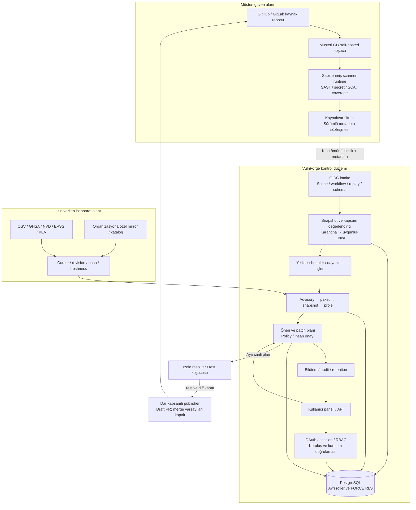
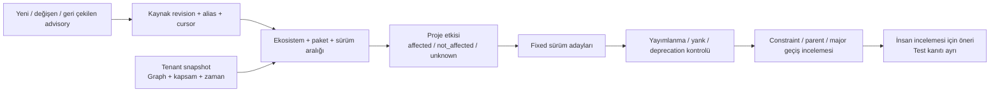
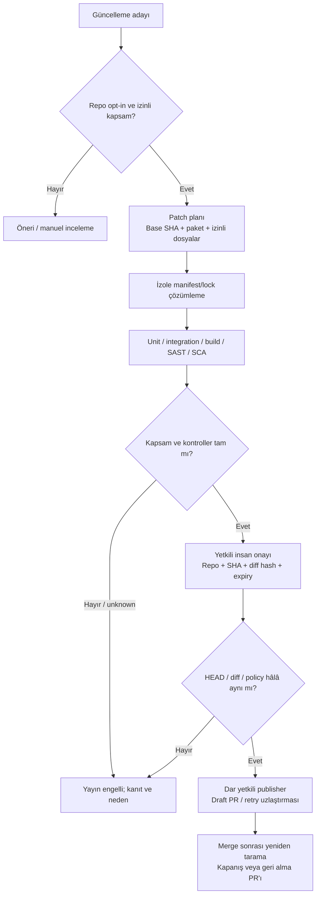

# VulnForge — Tamamlanmış ürünün hedef mimarisi

**Tarih:** 28 Ekim 2026. **Kapsam:** kaynak erişimi olmayan varsayılan müşteri modeli, isteğe bağlı managed analiz ve kontrollü düzeltme dahil nihai ürün tasarımı.

Bu belge hedef mimaridir; bileşenin burada tarif edilmesi uygulandığı anlamına gelmez. Bugünkü kod/kanıt [görev listesinde](docs/TASKS_TR.md) tutulur. Yerel testler, canlı sağlayıcı veya üretim kabulünün yerine geçmez. Worker DB izolasyonu, private katalog ve güvenilir runner baseline promotion tamamlanmadan müşteri alımı açılmaz.

## 1. Mimari ilkeler

1. **Kod müşteri koşucusunda kalır.** Kontrol düzlemi varsayılan olarak Contents veya repo yazma izni almaz. Repo içeriğini okuyan müşteri workflow'u platform App'inden ayrı bir yetki alanıdır.
2. **Kimlik, kapsam, bütünlük ve doğruluk farklı kanıtlardır.** İmzalı token doğru repo/workflow kimliğini gösterebilir; eksik taramayı tam hale getirmez. Her sonuç snapshot, kapsam, araç/kural sürümü ve kaynak revision ile bağlanır.
3. **Belirsizlik veri modelidir.** Eksik graph, unsupported range, eski feed veya başarısız tarama `unknown/under_investigation` üretir. Pozitif gözlem korunabilir; güncel negatif sonuç veya doğrulanmış öneri uydurulmaz.
4. **Tenant sınırı bütün katmanlardadır.** API, DB, iş kuyruğu, cache, katalog, dosya/artifact, bildirim ve operatör işlemi aynı organizasyon/bağlantı kapsamını taşır.
5. **Yazma yetkisi en son aşamada verilir.** Bağlantı, tarama ve öneri oluşturma PR yazma izni değildir. Kaynak erişimi, patch çalıştırma, PR yayınlama ve merge ayrı kapılardır.
6. **Geri alınabilir ve izlenebilir işlemler.** Retry idempotent olmalı; dış etki varsa mevcut durum uzlaştırılmalıdır. Audit, approval, retention ve restore akışı ürünün parçasıdır.

## 2. Kontrol düzlemi ve tarama düzlemi



Kontrol düzlemi planlama, kanıt ve kullanıcı erişimini yönetir. Tarama düzlemi kaynakla temas eder. Managed mod seçilirse kaynakla temas eden ek düzlem ayrıca kurulup yetkilendirilir; API/istihbarat worker'ı otomatik build/test ortamına dönüşmez.

### Bileşen sorumlulukları

| Bileşen | Sorumluluk | Alamayacağı varsayılan yetki |
|---|---|---|
| Web/API ve kimlik servisi | Session, kuruluş, üyelik, consent, proje görünümü | Genel repo kaynak/yazma yetkisi; customer session ile operatör erişimi. |
| Metadata bağlantı doğrulayıcı | User/App erişim kesişimi, repo admin, installation ve immutable ID | Contents/diff/commit içeriği okuma. |
| Runner intake | Token, scope, immutable workflow, payload ve replay kontrolü | Beyana dayanarak baseline veya patch yetkilendirme. |
| Snapshot değerlendirici | Tamlık, freshness, provenance ve baseline uygunluğu | Eksik rapordan temiz sonuç çıkarma. |
| Scheduler ve job authorizer | Tenant kapsamlı iş planlama, lease ve dar DB iş kanıtı | Worker'a genel operatör bağlantısı aktarma. |
| İstihbarat ingester | Feed cursor/revision/withdrawal ve katalog tazeliği | Özel müşteri paketlerini izinsiz public kaynağa sorgulama. |
| Etki/öneri worker'ı | Kayıtlı snapshot ve katalogdan etki, alternatif sürüm | Kaynak kod çalıştırma veya yazma anahtarı alma. |
| Resolver/test sandbox'ı | İzinli patch'in sınırlı doğrulaması | Ortak host, kalıcı volume, API/OAuth sırları veya sınırsız egress. |
| Publisher | Güncel plan/approval/test için draft PR uzlaştırması | Değişmiş diff'i yayımlama veya varsayılan otomatik merge. |
| Bildirim ve bakım | Kullanıcı tercihleri, dedup, silme/restore ve audit | Tenant verisini başka müşteri/kanala gönderme. |

## 3. Kullanıcı, GitHub bağlantısı ve consent

Giriş OAuth state, browser binding, S256 PKCE ve sabit callback ile başlar. Platform kimliği değişebilir login adı yerine immutable GitHub ID'ye bağlanır. Oturum opaque ve süreli, DB kaydı hash'li, mutation işlemleri Origin/CSRF korumalıdır.

Bir kullanıcı birden fazla yerel kuruluşa üye olabilir; yerel kuruluş adı GitHub organizasyonu sahipliğini kanıtlamaz. Proje bağlantısında hem yerel Org Admin yetkisi hem GitHub'daki repo yönetici yetkisi aranır. App'in repo erişimi ayrıca doğrulanır. Rastgele installation ID, URL veya repo adı yeterli değildir.

```mermaid
sequenceDiagram
  actor User as Kullanıcı
  participant UI as Panel
  participant API as Kimlik / bağlantı API
  participant GH as GitHub
  participant DB as PostgreSQL
  User->>UI: Kuruluş ve proje seç; metadata politikasını onayla
  UI->>API: Session + CSRF ile bağlantı başlat
  API->>DB: Session/org/repo/consent bağlı tek kullanımlık intent
  API-->>UI: Sabit callback içeren OAuth yönlendirmesi
  UI->>GH: Kullanıcı hesabını ve App erişimini doğrula
  GH->>API: Code + state callback
  API->>DB: State, browser, session ve mevcut yetkiyi tüket/doğrula
  API->>GH: Kullanıcı kimliği + erişilebilir installation/repo kontrolü
  API->>GH: Metadata-only App ile aktif repo/owner/branch doğrulaması
  API->>DB: Yetki/connection tekrar kontrolü; sahiplik ve consent kaydı
  API-->>UI: Bağlandı; ilk doğrulanmış koşucu raporu bekleniyor
```

Provider access/refresh token'ları kalıcı müşteri credential deposuna dönüşmez. Varsayılan bağlantı akışında callback belleğinde kullanılır. Repo ve hesap erişimi kaldırıldığında yeni iş/rapor engellenir; çalışan işin sonraki yan etkisi ve sonuç yazımı durdurulur. Webhook yanında periyodik uzlaştırma gerekir; yalnız webhook teslimatına güvenilmez.

Kaynak erişimi, public paket paylaşımı, managed analiz, uzaktaki model ve düzeltme yazma yetkisi ayrı consent kapsamlarıdır. Bir kutucuğa onay vermek bütün bu izinleri açmaz. Aktif her modun izin ve veri etkisi kullanıcıya açıklanır.

## 4. Koşucu ve kanıt güven modeli

Scanner runtime, müşteri checkout'undan ayrı ve immutable dağıtımdır. Platformun kural/araç sürümü customer repo içindeki config veya çalıştırılabilir dosyayla sessizce değiştirilemez. Statik analiz aşaması repo'nun kurulum/build/test script'lerini çalıştırmaz.

Her kabul edilebilir rapor; repo/connection, analiz edilen SHA, tarama türü, araç/kural sürümü, kapsam, manifest digest'leri, run/attempt ve rapor hash'ini taşır. Eksik dosya, parser hatası ve limit aşımı yapılandırılmış kapsam nedeni olarak kaydedilir. Büyük projelerde partition/manifest sözleşmesi tamamlanmadan rapor kesilerek complete ilan edilmez.

OIDC yalnız sabit issuer/audience, tanınan algoritma ve güvenilen anahtarla doğrulanır. JWKS/header URL'si token'dan seçilmez. Workflow platform onaylı tam commit referansıyla eşleşir. Yetki, isim metni veya subject string parçalamaya dayanmaz; immutable ID ve güncel bağlantı esas alınır.

| Kanıt sınıfı | İzin verilen etki | İzin verilmeyen etki |
|---|---|---|
| Doğrulanmış varsayılan dal snapshot'ı | Tamlık/tazelik/provenance kapıları sonrası baseline adayı | Sadece token geçerli diye otomatik güvenli proje ilanı. |
| Doğrulanmış PR analizi | Yalnız ilgili PR/target SHA bulguları | Varsayılan dal inventory'sini değiştirme veya eski baseline bulgusunu kapatma. |
| Güvenilmeyen fork/workflow sonucu | Yerel CI sonucu veya açıkça güvenilmeyen kanıt | Sır, ayrıcalıklı upload, baseline veya repo yazma yetkisi. |
| İzinli managed tarama | Açık kaynak consent'i ve izole koşucu sınırında kanıt | API/worker'ın genel hostunda müşteri kodu çalıştırma. |
| Manuel/operatör raporu | Karantina ve inceleme | Doğrulanmış source/workflow kanıtının yerine geçme. |

PR analizi için güvenilen workflow'un **çalıştırma SHA'sı** ile **analiz edilen PR SHA'sı** ayrı alanlardır. Bunların aynı olduğu varsayılmaz. Güvenilir PR profili ayrıca target/repo metadata'sı ve artifact bütünlüğüyle bağlanır. Fork kodu ayrıcalıklı aşamada çalıştırılmaz; artifact veya rapor script olarak execute edilmez. Bu hedef sözleşme bugünkü v1 intake'ın PR kabul ettiği anlamına gelmez: mevcut önizleme yalnız protected branch push/schedule/workflow_dispatch kabul eder.

Tekrar teslimde aynı kanıt aynı receipt'e gider; aynı run/kind için farklı içerik sessizce üzerine yazılmaz. Token nonce kullanımı ve receipt/audit atomik kaydedilir. Token süresi, policy zamanı ve connection epoch ağ beklemesinden sonra yeniden kontrol edilir.

## 5. Tarama motorları ve envanter

Hedef analiz hattı dört ayrı çıktı üretir:

- **Kod analizi:** Güvenilen sabit Semgrep kuralları ve desteklenen AST analizleri. Dil/dosya kapsamı, atlanan yollar ve parse hataları raporlanır.
- **Sır analizi:** Sabitlenmiş secret scanner. Sırın kendisi, snippet veya stdout DB/export/log'a taşınmaz; gerekli fingerprint ve maskeli konum kanıtı üretilir.
- **Bağımlılık grafı:** Ekosisteme uygun lock/build list, direct/transitive ve runtime/dev ayrımı, kaynak türü, constraint ve edge bilgisi. Marker/extras/workspace/git/local belirsizliği gizlenmez.
- **Snapshot çıktıları:** Kanıta bağlı SBOM, SARIF ve gerektiğinde SPDX/VEX. Resmi şemalarla doğrulama, kapsam ve envanter farkı bulunur.

Bağımlılık çözümleme statik parser'dan farklı risk taşır. Resolver gerekiyorsa geçici, sır içermeyen ve sınırlandırılmış ortamda çalışır. Paket veya build script'i API/scheduler hostunda execute edilmez. Ağ, dosya sistemi, CPU, bellek, süre ve çıktı sınırları tek başına Docker kullanılmış olmasıyla karşılanmış sayılmaz.

## 6. İstihbarat, proje etkisi ve sürüm önerisi

Feed ingestion tarama işinden ayrıdır. Her kaynağın cursor'u, son başarılı sorgusu, kaynak revision/hash'i ve withdrawal durumu saklanır. Kesinti sonrası kaldığı yerden devam, duplicate event ve revision uzlaştırması gerekir. Public katalog ile özel müşteri mirror'ı ayrı namespace'tir; özel advisory içeriği ortak cache veya tenant dışı alias sorgusuna sızmaz.



Etki kaydı advisory revision, paket gözlemi ve snapshot'ı birlikte referanslar. Yeni kaynak revision'ı eski negatif sonucu tekrar değerlendirmeye açar. Geri çekilmiş advisory için eski öneri etkin kalmaz. Tam olmayan inventory, paketin bulunmadığına dair kesin negatif kanıt değildir.

Severity, müdahale önceliği ve istismar olasılığı ayrı kavramlardır. CVSS kaynak vektörü/versiyonu, KEV üyeliği, EPSS gözlem zamanı, ortam ve exposure bilgisi ayrı saklanır. Reachability veya runtime exposure kanıtı yoksa risk otomatik düşürülmez.

Hedef sürüm için şu durumlar ayrı gösterilir: advisory dışında olmak, registry'de yayımlanmış olmak, yank/deprecated olmamak, mevcut constraint'e uymak ve proje testlerinden geçmek. Birinin doğru olması diğerlerini kanıtlamaz.

## 7. Freshness ve baseline kapısı

Baseline, yalnız şu kanıtların birlikte geçerli olmasıyla ilerler:

1. Doğru organizasyon/repo/aktif connection ve izinli tarama profili.
2. Doğrulanmış workflow/araç/kural sürümü ve SHA/manifest bütünlüğü.
3. Kapsamın tamamlanmış, dependency graph'ın gerekli düzeyde çözümlenmiş olması.
4. Snapshot'ın doğru varsayılan dala ait olması; sonradan gelen push, branch değişimi veya yeni başarısız taramayla geçersizleşmemesi.
5. Envanter ve istihbarat kanıtının tanımlanan tazelik penceresinde olması.

Eski complete sonuç, yeni failed/incomplete/running tarama yerine güncel sonuç olarak seçilmez. Tarihsel gözlem korunur; kullanıcıya etkili durum ve neden gösterilir. Öneri eskiyse aktif hedef kaldırılır, geçmiş hedef ayrı alanda tutulur. UI ve export aynı politika fonksiyonunu kullanır.

Mevcut yerel politika 24 saat inventory / 1 saat başarılı paket sorgusu penceresidir; ölçülmüş üretim SLO'su değildir. Bu pencere global feed'in dünyanın en yeni duyurusuna ulaştığını veya HEAD'in değişmediğini tek başına kanıtlamaz. [Mevcut uygulama ve API anlamı](docs/EVIDENCE_FRESHNESS_TR.md).

## 8. Kontrollü düzeltme ve PR yayınlama



Patch planı hedef sürüm, constraint/major geçiş, izinli yollar, manifest/lockfile digesti ve gereken kontrolleri kapsar. Repo keyfi build komutu belirleyip platform sırlarına erişemez. Gerekli test yoksa başarılı varsayılmaz. Başarısız/eksik analiz, değişen HEAD, yeni diff, policy iptali veya expired approval yayın iznini kaldırır.

Publisher yalnız o plan için kısa ömürlü repo/izin kapsamlı credential alır. Retry'da mevcut branch/PR uzlaştırılır; duplicate PR veya insan değişikliğinin üzerine yazma yapılmaz. Harici GitHub etkisinin DB transaction'ıyla tam exactly-once olduğu iddia edilmez. Automerge ayrı, varsayılan kapalı ve dar pilot kabulüne bağlıdır.

## 9. Tenant izolasyonu ve iş yürütme

Tenant bağlamı server tarafından kurulur: `organization → repository ownership → active connection → job claim → snapshot`. Payload içindeki organization/installation alanları yetki oluşturmaz. Repo silinip eklendiğinde veya sahiplik/installation değiştiğinde connection epoch yenilenir; eski iş ve token yeni bağlantıya yazamaz.

PostgreSQL rollerinin hedef ayrımı:

| Rol | Yetki alanı |
|---|---|
| Migration sahibi | DDL, kontrollü migration/provisioning; runtime'da kullanılmaz. |
| Kimlik/bağlantı servisi | Session ve onboarding için dar private işlemler. |
| Customer runtime | Geçerli session ve güncel üyelikle RLS kapsamlı müşteri okuma/mutation. |
| Job authorizer | Claim ve süreli iş kanıtı üretme/yenileme; source çalıştırmaz. |
| Job worker | Yalnız canlı job kanıtındaki repo/scan/namespace; genel operator SQL'i yok. |
| Catalog runtime | Public veya atanmış private katalog namespace'i. |
| Publisher | Onaylı plan ve dar yazma credential'ı; sır deposunun tamamı yok. |
| Operatör | Ayrı, kayıtlı, denetlenen destek/işletim işlemleri; müşteri session'ı değildir. |

RLS, FORCE RLS, role ACL ve güvenilen DB helper birlikte uygulanır. Kullanıcının değiştirebildiği connection setting/rol string'i yetki kanıtı sayılmaz. Tenant kapsamındaki tablo, sequence, function, cache ve artifact için ham SQL/cross-account testleri gerekir.

İş kuyruğu lease/heartbeat, claim token, bounded retry/backoff ve dead-letter akışını taşır. Uzun provider beklemesinde DB transaction'ı tutulmaz. Sonuç yazımından önce canlı claim/connection tekrar doğrulanır. Fair scheduling, tenant eşzamanlılığı, scan/API kotası ve payload limitleri noisy-neighbor/abuse etkisini sınırlar.

Public cache anahtarı public veriyle sınırlıdır. Private key, org/connection/catalog/source revision içerir; müşteri adına veya advisory ID'sine bakarak tenant dışı cache paylaşımı yapılmaz. İş bitişi/iptalinde geçici credential/cache temizlenir; core dump/swap/APM sınırları ayrıca işletim kontrolüdür.

## 10. Kavramsal veri modeli

Bu model hedef alanları gösterir; fiziksel migration sözleşmesi değildir. Mevcut SQL dosyaları sürümlü ve checksum kontrollüdür; uygulanmış migration değiştirilmez.

| Varlık grubu | Esas bağ ve kanıt |
|---|---|
| Kullanıcı / kuruluş / üyelik / davet | Immutable sağlayıcı ID, rol, session, davet hash/expiry ve erişim değişimi. |
| Integration / repo ownership / connection | Sağlayıcı, installation/repo/owner ID, mode, izin, consent ve connection epoch. |
| Workflow policy / rapor receipt | Güvenilen ref, run/attempt, execution/target SHA ayrımı, token nonce hash, payload hash ve trust state. |
| Snapshot / manifest / dependency edge | Analiz edilen commit, araç/kural sürümü, coverage, kaynak türü, direct/transitive graph ve digest. |
| Finding / observation / triage | Normalize fingerprint, snapshot gözlemi, gerekçe, sahip, risk kabulü/suppression expiry ve geçmiş. |
| Advisory / revision / alias / cursor | Namespace, kaynak revision/hash/zaman, withdrawn ve eşleme geçmişi. |
| Impact / recommendation | Advisory revision + paket gözlemi + snapshot; effective state, registry ve uyumluluk kanıtı. |
| Patch plan / validation / approval / PR | Base SHA, izinli diff, kontroller, sandbox kanıtı, kişi/expiry ve yayın uzlaştırması. |
| Notification / audit / deletion request | Tenant/kanal kapsamı, dedup, değişmez audit, silme tombstone'u ve restore sonrası tekrar uygulama. |

Bir repo veya tenant silindiğinde normal kayıtların yeniden canlanmaması gerekir. Public advisory kataloğu müşteri silmesiyle silinmeyebilir; private katalog ve müşteriyle ilişkili gözlemler aynı silme kapsamına tabidir.

## 11. Panel, bildirim ve API sözleşmesi

Panel; kuruluş/repo bağlamını, rolü, bağlantı sağlığını, son geçerli snapshot'ı, kapsam/freshness nedenlerini, açıkları ve önerilerin bilinmeyenlerini birlikte gösterir. Risk kabulü ve false-positive işlemleri gerekçeli, rollü ve süreli olmalıdır. Triage bulgunun geçmiş gözlemini silmez.

Bildirimler kullanıcı/kuruluş tercihlerine göre e-posta/Slack/Teams gibi kanallara gider. Aynı advisory/project/revision için tekrarlar toplulaştırılır; escalation sahip/SLA politikasına bağlıdır. Mesajlar kaynak/sır veya gereksiz özel paket ayrıntısı taşımaz; kanalın doğru tenant'a ait olduğu doğrulanır.

API; versioned schema, bounded payload/page, cursor, request/correlation ID, tutarlı hata ve mutation idempotency kullanır. Hassas callback query'leri ve token'lar access log'a yazılmaz. Browser'da operatör token'ı kalıcı depolanmaz. Genel admin API'si customer API yerine kullanılamaz.

## 12. Dağıtım, sırlar ve işletim

Development, staging ve production hesap, DB, App kaydı, webhook secret ve anahtar bakımından ayrıdır. Metadata, managed-read ve remediation-write entegrasyonları ayrı privilege domain'leridir. OAuth secret yalnız kimlik düzlemine, yazma anahtarı yalnız izinli publisher'a verilir. Anahtar rotasyonu, eski token erişimi ve revoke kabulü test edilir.

TLS ingress, private DB ağı ve egress allowlist sınırları altyapıda uygulanır. Müşteri self-hosted/on-prem modeli dışa kapalı katalog ve yerel artifact deposuyla çalışabilir; tek bir URL ayarı ağ izolasyonu kanıtı değildir. Veri bölgesi ve tenant'a özel anahtar/ortam kurumsal seçeneklerdir.

Kilitli bağımlılıklar, immutable scanner/workflow, pinned container digest, SBOM/checksum ve build provenance dağıtımın parçasıdır. Hash, üreticinin veya paketin güvenlik garantisi değildir. API container'ının root olmaması ve read-only açılması, müşteri kodu çalıştıran patch sandbox'ının test edildiğini göstermez.

Retention ve silme işleri aktif veriyi, cache/artifact'ı ve yedek dönüş penceresini kapsar. Restore sırasında silme tombstone'ları yeniden uygulanır; eski job veya installation otomatik etkinleşmez. RPO/RTO, alarm ve SLO hedefleri pilot ölçümü ve gerçek restore tatbikatıyla belirlenir; ölçülmemiş sayı taahhüt edilmez. [Saklama hedefleri](docs/DATA_RETENTION_TR.md).

Korelasyon zinciri `delivery → job/claim → scan/snapshot → finding/impact → plan/validation → approval → PR` şeklindedir. Operasyon metrikleri kuyruk yaşı, tarama süresi, kapsama eksikliği, feed yaşı, provider hatası, kota ve yayın engelini taşır. Log/APM etiketleri hassas metadata için ayrıca filtrelenir.

## 13. Opsiyonel ve kurumsal tamamlayıcılar

GitLab adapter'ı ortak kimlik/event/snapshot sözleşmesine bağlanır; GitHub izni veya subject biçimi GitLab'a kopyalanmaz. Kurumsal SSO/üyelik uzlaştırması, yerel RBAC ve tenant isolation sınırını kaldırmaz.

Model destekli triage/patch varsayılan kapalıdır. Repo/advisory içeriği talimat değil, güvenilmeyen veridir. Model doğrudan tool/credential yetkisi alamaz; yapılandırılmış öneri policy gate'ten geçer. Yerel ve uzaktaki model aynı onay/test kapılarına tabidir. Prompt injection, veri dışarı çıkarma ve model hatası negatif değerlendirmelerle test edilir.

Kullanım/plan/bütçe görünürlüğü ve gerekiyorsa faturalandırma daha sonra eklenebilir. Plan seviyesi güvenlik kapısını atlama yetkisi oluşturmaz. Veri bölgesi, ayrı müşteri ortamı ve compliance gereksinimleri açık sözleşme ve bağımsız denetimle ürünleşir; otomatik sertifikasyon iddiası yoktur.

## 14. Tamamlanmış sayılma ölçütleri

Ürün; kod dosyaları var diye tamamlanmış sayılmaz. Gerçek GitHub/CI üzerinde kurulum, ilk snapshot, push/PR, yeni/revize/withdrawn advisory, öneri, revoke/uninstall ve yeniden bağlama zinciri kabul edilmelidir. İki bağımsız müşteriyle ham SQL dahil cross-account testleri; resolver sandbox egress/kaçış/kaynak sınırları; silme/restore/rotasyon; yük ve false-positive ölçümleri; bağımsız güvenlik incelemesi gerekir.

Yayın raporu; kullanılan commit/artifact hash'lerini, geçti/kaldı/unknown kontrollerini ve kalan riskleri içerir. Genel yayın ve otomatik merge ayrı onay kapılarıdır. Uygulama ilerledikçe bu hedef mimariyle gerçek durum arasındaki fark [TASKS_TR.md](docs/TASKS_TR.md) ve [uygunluk kaydında](docs/REQUIREMENTS_COMPLIANCE_TR.md) görünür tutulur.
