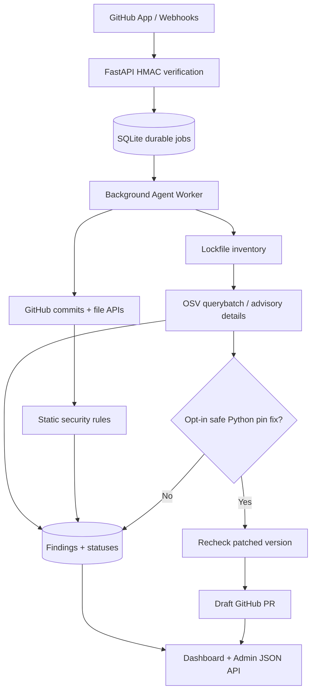

# VulnForge MVP — Commit Security + CVE Auto-Remediation

A **working GitHub App backend**, consisting of a FastAPI webhook receiver, a durable SQLite job queue, a separate background worker, basic static security rules, OSV vulnerability checks and opt-in draft security pull requests. **Not a production-grade SAST engine and not yet an LLM-powered agent.** It is the executable first milestone of the larger AI-security-agent design.

## Scope today

- Verify `X-Hub-Signature-256` using HMAC-SHA256 and deduplicate `X-GitHub-Delivery`.
- Subscribe to `push`, `installation`, `installation_repositories`, `dependabot_alert`, `security_advisory`.
- Cover each commit in a push via GitHub's paginated Compare API (GitHub webhook commit lists have limits); retry failed jobs.
- Read changed Python/JS/TS source over the Contents API **without executing project code**. Detect possible tokens, `eval`/`exec`, `shell=True`, JS `eval` and `innerHTML` sinks with explicit rule IDs. These rules are intentionally incomplete and can raise false positives.
- Inventory pinned dependencies in `requirements.txt`, `poetry.lock`, `package-lock.json`, `Cargo.lock`, `go.mod`, `composer.lock` and query OSV for existing known advisories. Match newly published global GitHub security advisories against the stored dependency inventory to trigger targeted rescans; also periodically recheck all registered repositories, even when no new commit is pushed.
- Store per-repo findings, close resolved dependency findings after a successful full audit, display a minimal web dashboard, expose admin-authenticated JSON API.
- When opted in, for **exact pinned Python requirements.txt dependencies only**, find a fixed OSV version, query that version again, update a new branch and create a **draft PR**. No auto-merge or CI status verification in this milestone.

## Prerequisites

Python 3.11+ and a GitHub App installed in repositories you own or are authorized to protect.

## Local development

```bash
python -m venv .venv
source .venv/bin/activate               # Windows: .venv\\Scripts\\activate
pip install -e '.[dev]'
cp .env.example .env
# Generate two different random values for WEBHOOK_SECRET and ADMIN_TOKEN.
# Set GITHUB_APP_ID and place downloaded GitHub App private key in ./private-key.pem.
# Load .env into environment (see below) OR configure env variables in your shell.
set -a; source .env; set +a
pytest -q
uvicorn vulnforge.api:app --reload --port 8000
# A second terminal with the same environment:
python -m vulnforge.worker
```

Windows PowerShell: set environment variables individually, or use Docker Compose with `.env`.

### Docker Compose

```bash
cp .env.example .env
# Edit the two secrets, app ID, and store the private key as ./private-key.pem
# Do not commit the secrets or the private key!
docker compose up --build -d
```

The dashboard is at `http://127.0.0.1:8000/` (local only). A reverse proxy providing HTTPS, access controls and webhook reachability is needed to receive GitHub events on the public internet. **Never expose the admin dashboard unauthenticated.**

## GitHub App configuration

1. GitHub → Settings → Developer settings → GitHub Apps → New GitHub App.
2. Webhook URL: `https://YOUR-DOMAIN/github/webhook`; webhook secret: the value of `WEBHOOK_SECRET`.
3. Repository permissions: **Contents: Read**, **Metadata: Read**, **Dependabot alerts: Read** (where available). Subscribe to `push`, `installation`, `installation_repositories`, `dependabot_alert`, `security_advisory`. Install into selected repositories only.
4. For draft PR creation set **Contents: Read & Write**, **Pull requests: Read & Write**. GitHub prompts to approve the extra privileges. Do not grant write permissions until you actually need them. Set `ENABLE_AUTO_PR=true` only then.
5. Create a **private key** for the app and set `GITHUB_PRIVATE_KEY_PATH` to its local file path. Never send the key to a language model.
6. Configure CI / branch protection in each protected repo; VulnForge never bypasses review and never merges on your behalf in this version.

Health check: `GET /health`. Dashboard: `GET /`. Dependency inventory: `GET /api/dependencies`. API calls need `Authorization: Bearer ADMIN_TOKEN`.

```bash
curl -H "Authorization: Bearer $ADMIN_TOKEN" http://127.0.0.1:8000/api/repositories
curl -H "Authorization: Bearer $ADMIN_TOKEN" http://127.0.0.1:8000/api/findings
curl -X POST -H "Authorization: Bearer $ADMIN_TOKEN" \
  "http://127.0.0.1:8000/api/rescan?repo=ORG/REPO"
```

## Architecture



## Developer notes and explicit constraints

- **Safety:** Project code isn't executed. Source isn't forwarded to an LLM. Read/skipped-file coverage is recorded for supported extensions. API hosts are configured by an operator, not read from webhook data. Read limits cap files and Git trees; oversized/incomplete audits **fail**, instead of pretending full coverage.
- **Vulnerability sources:** Initial feed = OSV + GitHub `dependabot_alert`/global `security_advisory` triggers; standalone CISA KEV, NVD, full GHSA ingestion, exploitability analysis and reachability analysis are future milestones.
- **No magic patching:** GitHub PR generation is for narrowly supported `requirements.txt` exact pins. npm lockfile regeneration, multi-file coordinated upgrades, writing tests, test-run sandboxing, AI patch ranking, and verifying CI are still TODOs.
- **Reliability:** Queue is SQLite with retry and at-least-once semantics; use Postgres + Redis/Celery or another durable broker for many thousands of repositories. A process killed while processing may retry; deterministic job keys help prevent duplicates.
- **Known limit:** GitHub's webhook events can be missed if deliveries exceed size limits or during long outages. Periodic dependency audits catch new CVEs, but complete commit-history reconciliation and webhook delivery backfill aren't built yet.
- **Private repos:** Contents and dependency metadata remain in process and SQLite; store the SQLite volume encrypted as appropriate and restrict its filesystem permissions. Alerts may contain package names, filenames and snippets; sample static rules redact credential evidence.
- **Severity:** `high`/`medium` labels are heuristic in this MVP, *not* verified CVSS/EPSS/KEV scores. No verified reachability claim.
- **Admin:** The dashboard requires an admin token to access its JSON APIs. For internet-facing deployments additionally put `/` and `/api/*` behind a strong identity-aware proxy, implement rate limiting and audit logs.

## Next milestones

1. Add Semgrep/CodeQL SARIF imports, suppressions, scan coverage metadata and unit-tested rules.
2. Add NVD / GHSA / CISA KEV change feeds and event-driven intelligence, with version, environment and exploitability reasoning.
3. Add isolated ephemeral CI/test runners, PR checks, rollback strategy and strict auto-merge policy.
4. Add an opt-in LLM agent with tool allowlists, model-data minimization, human approvals and prompt-injection defenses.
5. Add Postgres, tenant isolation, GitHub Checks annotations, observability and security hardening before production.

## Sources

- [GitHub verifying webhooks](https://docs.github.com/en/webhooks/using-webhooks/validating-webhook-deliveries)
- [GitHub push webhook contract](https://docs.github.com/en/webhooks/webhook-events-and-payloads#push)
- [GitHub compare commits API](https://docs.github.com/en/rest/commits/commits#compare-two-commits)
- [GitHub App installation access tokens](https://docs.github.com/en/apps/creating-github-apps/authenticating-with-a-github-app/authenticating-as-a-github-app-installation)
- [OSV querybatch API](https://google.github.io/osv.dev/post-v1-querybatch/)
