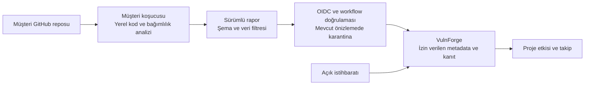

# VulnForge

**Kaynak kodu müşteri ortamında tutmayı esas alan, güvenlik açıklarını projelerle ilişkilendiren güvenlik platformu.**

VulnForge; kod ve bağımlılık bulgularını repo, commit ve tarama kapsamıyla bir araya getirir. Amacı, yeni bir CVE veya GHSA yayımlandığında hangi projenin neden etkilendiğini göstermek ve düzeltmeyi test, insan onayı ve yeniden tarama kanıtıyla takip etmektir.

> **Durum: geliştirme aşamasında — üretim kullanımına hazır değildir.** Son kayıtlı yerel doğrulama, 28 Ekim 2026 tarihinde 642 testin atlanmadan geçtiğini bildirir. 110 görevin 26'sı tamamlandı. GitHub/OSV çağrıları testlerde mock kullanır; canlı GitHub ve müşteri koşucusu kabulü, worker veritabanı izolasyonu ve müşteri envanterinin güvenilir başlangıç kaydı olarak kabulü hâlâ açıktır. [Görevler ve kabul koşulları](docs/TASKS_TR.md).

[Mimari](ARCHITECTURE.md) · [Yerel kurulum](#yerel-kurulum) · [Scanner kullanımı](#scanner-kullanımı) · [Geliştirme planı](#geliştirme-planı) · [Güvenlik](SECURITY.md)

## Ne için kullanılır?

VulnForge şu sorulara kanıtlarıyla cevap vermek üzere geliştiriliyor:

- Hangi proje, hangi paket ve sürüm nedeniyle bir güvenlik açığından etkileniyor?
- Sonuç hangi commit'e ait; envanter ve açık bilgisi ne kadar güncel?
- Analiz kapsamı yeterli mi, yoksa sonuç belirsiz mi?
- Hangi güncelleme adayları değerlendirilebilir; uyumluluk ve test kanıtı var mı?
- Düzeltme onaylandı mı ve birleştirme sonrasında yeniden doğrulandı mı?

Eksik veya eski kanıt, güvenli sonuç olarak sunulmaz. Desteklenmeyen sürüm aralıkları ve tamamlanmamış analizler `unknown` veya `under_investigation` olarak görünür.

## Bugün neler var?

Aşağıdaki bileşenler yerel geliştirme ve test kapsamında mevcuttur. Uçtan uca üretim kabulü ayrıca gereklidir.

| Alan | Mevcut yetenek | Açık sınır |
|---|---|---|
| Yerel tarama | Ağ çağrısı yapmadan çalışan CLI, temel AST/regex kod kuralları ve altı bağımlılık dosyası formatı | Semgrep/Gitleaks entegrasyonu ve tam çözümlenmiş bağımlılık grafı yok |
| GitHub bağlantısı | OAuth, oturum, rol kontrolleri ve kaynak erişimsiz proje bağlantısı önizlemesi | Canlı sağlayıcı kabulü, tam repo seçimi ve yetki değişimi uzlaştırması açık |
| Müşteri raporları | Sürümlü metadata şeması, kaynak/sır reddi, OIDC doğrulama kodu ve karantina | Raporların güvenilir proje envanterine alınması kapalı |
| Açık takibi | OSV ve imzalı GHSA akışı, proje etkisi, sürüm adayı kontrolleri ve isteğe bağlı KEV | Feed uzlaştırması, registry ve uyumluluk doğrulaması tamamlanmadı |
| Bulgular ve görünürlük | Yerel org/proje paneli, commit/kapsam/tazelik bilgisi, bulgu geçmişi, süreli suppression, SBOM/SARIF çıktıları | İleri panel, bildirimler ve çıktıların resmi şemalarla tam kabulü açık |
| Veri ve işler | PostgreSQL migration/RLS temeli, lease/retry/dead-letter kuyruk işlemleri | Worker DB rolü ve tüm arka plan işlerinde tenant izolasyonu açık |
| Düzeltme | Repo bazlı açık izin ve eksik doğrulamada yayını engelleyen kontroller | İzole resolver/test, SHA+diff onayı, draft PR yayını ve merge sonrası doğrulama hattı açık |

## Kaynak kod ve veri sınırları

Varsayılan **customer-runner** modelinde kaynak checkout'u ve analiz müşteri koşucusunda kalır. Platforma yalnız izin verilen metadata raporu gönderilmesi tasarlanır. Metadata-only GitHub App kaynak okuma/yazma izni istemez; müşteri workflow'unun checkout izni ayrı değerlendirilir.



- Rapor sözleşmesi ham kaynak, diff, snippet, stdout ve keyfi dosya eklerini reddeder. Dosya yolları özet kimliklere dönüştürülür; bu anonimlik garantisi değildir.
- Paket adları, sürümler, repo kimlikleri ve bulgu metadata'sı hassas olabilir. Dış servislere paket sorgusu ayrıca izin ve paket allowlist'i gerektirir; özel paket engeli önceliklidir.
- OIDC kimlik doğrulaması tek başına taramanın tam veya güncel olduğunu kanıtlamaz. Önizleme raporları güvenilir başlangıç envanterine otomatik geçirilmez.
- Yönetilen kaynak taraması ve düzeltme yazma yetkisi ayrı açık izin gerektirir. Otomatik birleştirme kapalıdır.
- Uzaktaki LLM kullanımı temel akışın ön koşulu değildir.

Ayrıntılar: [gizlilik mimarisi](docs/PRIVACY_ARCHITECTURE_TR.md), [saklama ve silme](docs/DATA_RETENTION_TR.md), [koşucu kimliği](docs/RUNNER_IDENTITY_TR.md).

## Yerel kurulum

Kilitli bağımlılıkların hedefi **CPython 3.11/3.12 ve Linux/macOS** ortamlarıdır. Tam veritabanı kontrolü için PostgreSQL araçları (`initdb`, `pg_ctl` ve gerektiğinde `pg_config`) erişilebilir olmalıdır.

```bash
git clone https://github.com/kaanirmak/VulnForge.git
cd VulnForge
python -m venv .venv
source .venv/bin/activate
python -m pip install --require-hashes --only-binary=:all: -r requirements/development.lock
python -m pip install --no-deps --no-build-isolation -e .
python -m pip check
python scripts/check.py --postgres
```

PostgreSQL kontrolü kendine ait geçici, yerel socket kullanan bir cluster oluşturur ve testlerden sonra temizler. Mevcut kullanıcı veritabanını kullanmaz. Yukarıdaki test sayısı son kayıtlı doğrulamaya aittir; bu kurulum adımları canlı sağlayıcı kabulü anlamına gelmez.

[Bağımlılık kilitleri ve tekrarlanabilir kurulum](docs/REPRODUCIBLE_SETUP_TR.md) · [Veritabanı taşıma](docs/DATABASE_MIGRATION_TR.md) · [Veritabanı izolasyonu](docs/DATABASE_ISOLATION_TR.md)

### Yerel API ve GitHub önizlemesi

`.env.example` üzerinden yerel `.env` dosyanı oluştur; mevcut dosyan varsa ayarları karşılaştırarak güncelle. Bağımsız rastgele sırları üret, dosyayı yalnız sahibinin okuyabileceği şekilde koru ve Git'e ekleme. Gerçek App/OAuth kurulumu için [ilk GitHub testi rehberini](docs/USER_NEXT_STEPS_TR.md) izle.

```bash
python -m vulnforge.setup_check --env-file .env
docker compose up --build -d
```

Ayar kontrolü `.env` dosyasını komut olarak çalıştırmaz, sağlayıcı isteği veya veritabanı yazması yapmaz. Varsayılan Compose yalnız API'yi `127.0.0.1:8000` üzerinde başlatır; App anahtarı bağlamaz ve kaynak tarama worker'ı başlatmaz. Eksik veya tutarsız OAuth ayarları açılışı engelleyebilir. Müşteri giriş/bağlantı önizlemesinin ek ayarları [bağlantı rehberinde](docs/PROJECT_CONNECTION_TR.md) açıklanır.

## Scanner kullanımı

Kurulumdan sonra güvenilen bir yerel checkout üzerinde kod ve bağımlılık raporlarını ayrı oluşturabilirsin:

```bash
python -I -m vulnforge.cli \
  --root . --repo kaanirmak/VulnForge --sha "$(git rev-parse HEAD)" \
  --kind code --output /tmp/vulnforge-code-report.json

python -I -m vulnforge.cli \
  --root . --repo kaanirmak/VulnForge --sha "$(git rev-parse HEAD)" \
  --kind dependencies --output /tmp/vulnforge-dependency-report.json
```

CLI proje kodunu çalıştırmaz; paket yöneticisi, build veya test başlatmaz; ağ çağrısı ve rapor yüklemesi yapmaz. Başka veya güvenilmeyen projeleri tararken scanner ortamını checkout dışında tut ve `--root` ile hedefi belirt. Repo ve SHA değerleri CLI'da beyan edilen metadata'dır; checkout kimliği için sunucudaki doğrulama ayrıca gerekir.

Desteklenen bağımlılık dosyaları: `requirements.txt`, `package-lock.json`, `poetry.lock`, `Cargo.lock`, `composer.lock` ve `go.mod`. Format desteği tam dolaylı bağımlılık grafı veya tüm ekosistem özelliklerinin çözümlendiği anlamına gelmez.

`--fail-on high` yüksek/kritik kod bulgularında başarısız çıkış kodu üretir. `--require-complete` eksik analiz için ayrı çıkış kodu verir. Varsayılan başarılı çıkış, projenin güvenli olduğu anlamına gelmez; rapordaki kapsam ve belirsizlikler değerlendirilmelidir.

[CLI sınırları ve Action şablonları](docs/RUNNER_TR.md) · [Workflow örnekleri](examples/workflows)

## Geliştirme planı

Hedef kullanıcı akışı: **GitHub ile giriş → proje bağlantısı → müşteri koşucusunda analiz → yeni açıklarla eşleştirme → güncelleme önerisi → test ve insan onayı → draft PR → merge sonrası yeniden tarama.**

Bu akışın tamamlanması için öncelikli işler:

1. Canlı GitHub/OIDC/Actions kabulü ve doğrulanmış müşteri envanteri akışı.
2. Worker veritabanı izolasyonu ve özel advisory kapsamı.
3. Gerçek scanner entegrasyonları, bağımlılık grafı ve sürdürülebilir feed senkronizasyonu.
4. İzole düzeltme/test ortamı, SHA ve diff'e bağlı onay, doğrulanmış PR yayını.
5. Bildirimler, işletim/geri yükleme/silme kanıtları, pilotlar ve bağımsız güvenlik incelemesi.

GitLab, kurumsal SSO, veri bölgesi ve plan/kullanım yönetimi sonraki ürün fazındadır. Tam ürün tasarımı [ARCHITECTURE.md](ARCHITECTURE.md), görevlerin kabul koşulları [TASKS_TR.md](docs/TASKS_TR.md) içinde tutulur.

## Katkı ve dokümantasyon

Değişiklikleri kapsama uygun kontrollerle doğrula; davranış, izin veya veri modeli değişiyorsa ilgili rehberleri de güncelle. Paket derlemesi temiz kaynak ağacında `python scripts/build_package.py --output dist` ile wheel, checksum ve kaynak manifesti üretir. `--allow-dirty` yalnız yerel önizleme içindir. Araç upload, tag veya release oluşturmaz.

| Belge | İçerik |
|---|---|
| [Mimari](ARCHITECTURE.md) | Bileşenler, veri modeli, güven sınırları ve hedef akışlar |
| [Görevler](docs/TASKS_TR.md) | Tamamlanan ve açık işler, kabul koşulları |
| [İlerleme](docs/BATCH_PROGRESS_TR.md) | Uygulama grupları ve kayıtlı doğrulama kanıtları |
| [Gereksinim uygunluğu](docs/REQUIREMENTS_COMPLIANCE_TR.md) | Hedef gereksinimlerin mevcut karşılığı |
| [Güvenlik](SECURITY.md) | Güvenlik sınırları ve mevcut kısıtlar |
| [Lisans değerlendirmesi](docs/LICENSE_REVIEW_TR.md) | Kod ve veri kaynaklarının lisans değerlendirmesi |

Üretim yayını; canlı kabul, izolasyon, geri yükleme/silme ve bağımsız inceleme koşulları tamamlanana kadar kapalıdır. Mevcut belgeler sertifikasyon, hukuki uygunluk veya sıfır güvenlik riski taahhüdü değildir.
