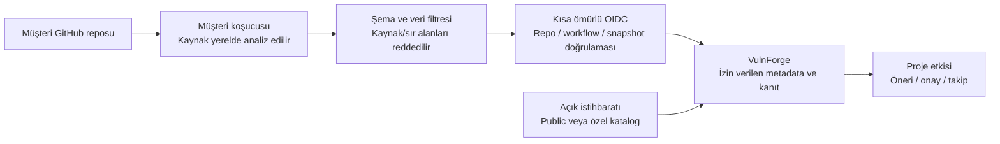

# VulnForge

**Kaynak kodu müşteri ortamında tutan; yeni güvenlik açıklarını projelerle eşleştiren ve doğrulanmış düzeltme sürecini yöneten güvenlik platformu.**

VulnForge'un tamamlanmış halinde ekip, GitHub hesabıyla giriş yapar, seçtiği projeleri bağlar ve müşteri koşucusunda çalışan tarama hattını kurar. Platform; hangi projenin hangi açıktan, hangi paket ve sürüm nedeniyle etkilendiğini gösterir, güncelleme seçeneklerini açıklar ve izin verilen değişiklikleri test ve insan onayından geçirerek draft PR'a dönüştürür.

> **Bu README tamamlanmış ürünün hedefini ve mevcut geliştirme durumunu birlikte gösterir.** Bütün özellikler bugün hazır değildir. 28 Ekim 2026 yerel doğrulaması: **642 test, sıfır skip; 26/110 görev tamamlandı.** Canlı GitHub/koşucu kabulü, worker DB izolasyonu ve güvenilir müşteri envanterinin baseline'a alınması açıktır. Üretim müşteri kabulü kapalıdır. [Gerçek görev durumu](docs/TASKS_TR.md).

## Çözdüğü problem

Yeni bir CVE veya GHSA yayımlandığında yalnız bir uyarı listesi görmek yeterli değildir. Ekibin şu sorulara cevap verebilmesi gerekir:

- Hangi projelerimiz, hangi snapshot ve paket/sürüm kanıtıyla etkileniyor?
- Bilgi güncel mi; tarama, envanter veya sürüm aralığı eksik mi?
- Hangi sürüm adayları açığın dışında; gerçekten yayımlanmışlar mı; major geçiş veya lockfile değişikliği gerekiyor mu?
- Önerilen değişiklik testlerden geçti mi, kim onayladı, hangi SHA ve diff için onaylandı?
- Açık düzeldi mi; PR birleştikten sonra yeniden taramayla doğrulandı mı?

VulnForge bu soruları repo, organizasyon, SHA, tarama kapsamı ve advisory geçmişiyle ilişkilendiren bir ürün olarak tasarlanır. Kanıt eksikse sonuç `unknown` veya `under_investigation` kalır; eksik analiz güvenli sonuç olarak sunulmaz.

## Tamamlanmış üründe kullanıcı akışı

1. **Giriş ve kuruluş:** Kullanıcı GitHub ile giriş yapar; kuruluşunu oluşturur veya daveti kabul eder. Org Admin, Maintainer, Analyst, Viewer ve Auditor rolleri farklı işlem yetkileri taşır.
2. **Proje bağlantısı:** Kullanıcı yalnız erişimini doğruladığı seçili projeleri bağlar. İstenen izinler, tarama modu, metadata paylaşımı ve saklama koşulları onaydan önce gösterilir.
3. **Koşucu kurulumu:** İncelenmiş ve commit SHA'sıyla sabitlenmiş Action/workflow müşteri reposuna eklenir. Scanner runtime'ı kaynak checkout'undan ayrı tutulur. İlk analiz snapshot kapsamını açıkça belirtir; geçmişin tamamı taranmış sayılmaz.
4. **Sürekli analiz:** Push, PR ve zamanlanmış profiller ayrı kapsamlarla çalışır. Kod, sır ve bağımlılık bulguları ortak şemaya dönüştürülür. PR ve fork sonuçları varsayılan dal envanterini değiştiremez.
5. **Yeni açık takibi:** Advisory kaynakları düzenli alınır; yeni/revize/geri çekilmiş kayıtlar mevcut snapshot'larla eşleştirilir. Etkilenen proje, paket, sürüm, kaynak ve belirsizlik görünürdür.
6. **Güncelleme önerisi:** Hedef sürüm, advisory aralıkları, paket kaydı, constraint ve dependency graph üzerinden değerlendirilir. Yayımlanma, uyumluluk ve test kanıtı birbirinden ayrı gösterilir.
7. **Kontrollü düzeltme:** Repo politikası izin veriyorsa patch planı üretilir. Manifest/lockfile, izole resolver ve test hattında doğrulanır. Onay SHA ve diff'e bağlanır; değişiklik sonrası onay geçersizleşir.
8. **PR ve kapanış:** Başarılı kontroller ve gerekli insan onayından sonra draft PR açılır. Otomatik merge varsayılan olarak kapalıdır. Merge sonrası yeniden tarama bulgunun kapanış kanıtını üretir.

## Kaynak kod nasıl korunur?

Varsayılan **customer-runner** modelinde checkout, kaynak dosyaları ve analiz müşteri koşucusunda kalır. Servise yalnız sürümlü ve sınırlandırılmış metadata raporu gönderilir. Metadata-only GitHub App kaynak okuma/yazma izni istemez. Müşteri workflow'unun kendi checkout izni ile platformun App izinleri ayrı sınırlar olarak değerlendirilir.



- Rapor şeması ham kaynak, diff, snippet, stdout ve keyfi dosya eklerini kabul etmez. Bilinen sır biçimleri ve gereksiz dosya yolu bilgileri filtrelenir.
- Paket adları, sürümleri, repo kimliği ve bulgu metadata'sı yine hassas olabilir. Şema, gizli kanal veya anonimlik garantisi değildir.
- OIDC ve platformun onayladığı immutable workflow, sırf göndericinin beyanına güvenilmesini engeller. Geçerli kimlik, taramanın tam veya güncel olduğunu tek başına kanıtlamaz.
- Public paket sorgusu ayrı izin ve paket allowlist'i gerektirir. Özel paket engeli önceliklidir; otomatik public fallback yapılmaz.
- **Managed scan** ayrı ve açık kaynak erişim onayı gerektiren moddur. **Düzeltme yazma yetkisi** de ayrıca sınırlandırılır. Bu yetkiler giriş/metadata App'ine eklenmez.
- Uzaktaki LLM kullanımı temel akışın ön koşulu değildir. İleride sunulacak model özellikleri ayrı onay, veri politikası ve araç kapılarından geçer.

[Ayrıntılı mimari](ARCHITECTURE.md), [veri sınırları](docs/PRIVACY_ARCHITECTURE_TR.md), [saklama hedefleri](docs/DATA_RETENTION_TR.md).

## Hedef yetenekler ve bugünkü karşılığı

| Alan | Tamamlanmış üründeki hedef | Mevcut durum |
|---|---|---|
| Hesap ve proje bağlantısı | GitHub giriş, kuruluş/ekip, seçili repo bağlantısı, yetki kaybı uzlaştırması | OAuth/session/RBAC, RLS ve yerel bağlantı önizlemesi testli; canlı kabul ve sürekli uzlaştırma açık. |
| Tarama | Sabitlenmiş SAST/secret araçları, resolved dependency graph, PR farkı | Offline CLI, temel AST/regex, altı manifest formatı; Semgrep/Gitleaks ve tam graph açık. |
| Müşteri raporu | Doğrulanmış workflow ve snapshot'tan envanter kabulü | OIDC kimlik kontrolü ve karantina var; baseline promotion kapalı. |
| Açık istihbaratı | Cursor/revision geçmişi, GHSA/OSV/NVD/EPSS/KEV ve özel katalog | OSV/signed GHSA etki akışı ve opsiyonel KEV var; diğer kaynak/uzlaştırmalar açık. |
| Tazelik | Eski/eksik kanıtın etkili sonucu ve öneriyi geçersizleştirmesi | API, ekran ve exportlarda uygulanıyor; global feed senkronizasyon garantisi değil. |
| Düzeltme | İzole resolver/test, SHA+diff onayı, draft PR ve merge sonrası doğrulama | Repo opt-in ve yayın engelleri var; doğrulama/approval/publisher hattı açık. |
| Panel ve bildirim | Risk/kapsam/geçmiş, sahip/SLA, kişisel bildirim tercihleri | Yerel org/proje/bulgu/etki ve onay ekranı var; ileri panel/bildirimler açık. |
| İşletim | Ayrı ortam/sırlar, adil kota, geri yükleme, silme kanıtı ve bağımsız inceleme | Locked kurulum, migration, RLS, lease/retry/DLQ ve yerel container kontrolü var; üretim kabulü açık. |
| Kurumsal kapsam | GitLab, SSO, on-prem, veri bölgesi, kullanım/plan yönetimi | Sonraki ürün fazı; uygulanmış sayılmaz. |

## Hedef teknoloji ve çalışma sınırları

Kontrol düzlemi Python/FastAPI ve PostgreSQL üzerine kuruludur. SQLite yerel geliştirme içindir. GitHub App kimliği, Actions OIDC ve müşteri koşucusu tarama düzlemini bağlar. Dayanıklı işler lease/claim, bağlantı kimliği ve organizasyon kapsamıyla yürütülür. Tenant verisi yalnız uygulama filtresiyle korunmaz; DB rolü ve RLS sınırı gerekir.

SBOM ve SARIF çıktıları snapshot'a bağlıdır. Hedef envanter modeli dependency edge, doğrudan/dolaylı ayrımı ve manifest digest'lerini taşır. İstihbarat önceliği; severity, KEV/EPSS, ortam ve exposure bilgisini ayrı kanıtlarla açıklar. Reachability bilinmiyorsa bilinmiyor olarak gösterilir.

Üretim mimarisi, veri modeli, güven sınırları ve uçtan uca akışlar [ARCHITECTURE.md](ARCHITECTURE.md) içindedir.

## Bugünkü kodu yerelde doğrulama

Kilitler CPython 3.11/3.12, Linux/macOS içindir. Proje kodunu çalıştırmadan önce güvenilen Python/pip ortamını kur:

```bash
python -m venv .venv
source .venv/bin/activate
python -m pip install --require-hashes --only-binary=:all: -r requirements/development.lock
python -m pip install --no-deps --no-build-isolation -e .
python -m pip check
python scripts/check.py --postgres
```

PostgreSQL kontrolü kendi geçici yerel cluster'ını kurar, testlerden sonra kapatıp temizler; kullanıcının mevcut DB'sini kullanmaz. Son yerel kabul **642 test, sıfır skip**. GitHub/OSV çağrıları testlerde mock'tur; bu sayı gerçek sağlayıcı kabulü değildir.

Default `docker compose up --build -d` yalnız API'yi loopback portunda çalıştırır; App anahtarı bağlamaz, source worker başlatmaz. Eksik OAuth alanlarıyla hazırlanmış yerel `.env` doldurulmadan uygulama başlamayı reddedebilir. Container açılışı ayrıca ağsız, salt okunur kök dosya sistemi ve UID 10001 ile test edildi. Bu kontrol patch sandbox'ı veya production altyapısı kabulü değildir.

[Kilitli kurulum ve artifact kanıtı](docs/REPRODUCIBLE_SETUP_TR.md), [veritabanı taşıma](docs/DATABASE_MIGRATION_TR.md), [DB izolasyonu](docs/DATABASE_ISOLATION_TR.md).

## İlk gerçek GitHub testi

Şu aşamada alan adı gerekmez. Private ve yalnız Metadata read isteyen bir test App'i, iki loopback callback ve tek test reposu hazırlanır. App ID, OAuth Client ID, Client Secret ve PEM dosyasının yolu yereldeki korumalı `.env` içine yazılır; sırlar sohbete veya Git'e gönderilmez.

[Adım adım senin yapacağın işlemler](docs/USER_NEXT_STEPS_TR.md). Ardından:

```bash
python -m vulnforge.setup_check --env-file .env
```

Bu kontrol literal ayarları okur; `.env`'i komut olarak çalıştırmaz, provider isteği veya DB yazması yapmaz. Yerel konfigürasyonun hazır olması üretim onayı değildir. [Bağlantı protokolü](docs/PROJECT_CONNECTION_TR.md).

## Katkı, dağıtım ve yayın kapısı

Her değişiklik kapsama uygun test, migration/rol etkisi ve dokümantasyonla değerlendirilir. Kilitli paket derlemesi checksum ve source manifest üretir:

```bash
python scripts/build_package.py --output dist
```

Temiz kaynak ağacı gerekir. `--allow-dirty` yalnız yerel önizleme içindir; çıktıyı doğrulanmış commit sürümü olarak işaretlemez. Araç upload/tag/release yapmaz. Dağıtım, immutable workflow referansları, canlı kabul, silme/restore ve bağımsız güvenlik incelemesi tamamlanmadan genel kullanıcıya açılmaz.

- [Tüm görevler ve tamamlanma kanıtları](docs/TASKS_TR.md)
- [Gereksinim uygunluğu](docs/REQUIREMENTS_COMPLIANCE_TR.md)
- [Toplu ilerleme](docs/BATCH_PROGRESS_TR.md)
- [Güvenlik sınırları](SECURITY.md)
- [Lisans ve veri kaynağı değerlendirmesi](docs/LICENSE_REVIEW_TR.md)

Bu hedef belge; mevcut olmayan özellik, ölçülmemiş SLO, hukuki uygunluk, sertifikasyon veya sıfır güvenlik riski taahhüdü değildir.
