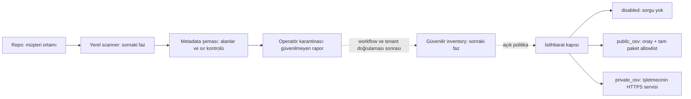

# Gizlilik mimarisi ve veri paylaşımı kararı

27 Ekim 2026 — VF-001–VF-009 tasarım ve ilk uygulama kaydı.

## Karar

Varsayılan `SCAN_MODE=customer_runner`. Sunucu GitHub kaynak dosyalarını veya commit/diff verisini bu modda okumaz. Varsayılan kurulum App anahtarı gerektirmez; açıkça etkinleştirilen runner identity önizlemesi, yalnız metadata sorgusu için ayrı App anahtarı kullanabilir. `INTELLIGENCE_MODE=disabled`: paket/sürüm sorgusu dışarı gönderilmez. Bu varsayılanlar, henüz tamamlanmayan müşteri/workflow kimlik doğrulamasının yerini tutmaz; uçtan uca müşteri koşucusu VF-031–040 kapsamında geliştirilecektir.

Varsayılan rapor girişi ayrı operatör token'ı ile erişilen karantina alanıdır. Ek olarak yalnız loopback önizlemesinde OIDC kimliği ve metadata App kontrolüyle identity-verified karantina vardır; [sınırları](RUNNER_IDENTITY_TR.md). Kayıtlar güvenilir scan, bağımlılık baseline'ı veya otomatik düzeltme yetkisi üretmez. API `/api/v1/privacy`, müşteri ingestion ve tenant izolasyonunun hazır olmadığını açıkça döndürür.

## İki çalışma modu ve izin ayrımı

| Mod | Kaynak erişimi | GitHub App tasarımı | Bugünkü durum |
|---|---|---|---|
| Customer runner | Müşterinin ortamında | Ayrı metadata App; Contents ve Pull requests yazma/okuma izinleri istenmez. İsteğe bağlı Checks yazma ayrı değerlendirilir. | Sunucu erişim kapıları ve rapor sözleşmesi var. Offline CLI/Action kodu ve yerel OIDC/metadata karantinası var; production workflow/installation kabulü ve baseline promotion açık. |
| Managed | Seçilen repolar; sunucuda geçici bellek | Ayrı Managed Scanner App: Contents read, Pull requests read. Checks write ayrıca opt-in. | Önceki tarama motoru açık onayla kullanılabilir; izole ortam/tenant güvenliği hazır olmadığı için çok müşterili yayına uygun değil. |
| Düzeltme yayını | Onaylanan dosya ve değişiklik | Ayrı Remediation App önerilir; Contents/Pull requests write. Tarama App'inin anahtarıyla ortak erişim verilmez. | Yardımcı kod mevcut; doğrulama/policy hattı bitmediğinden müşteri özelliği olarak açılmaz. |

GitHub App'in talep ettiği izin setini tenant başına bir UI anahtarıyla değiştirebileceğimizi varsaymıyoruz. Bu yüzden metadata, managed scan ve remediation için ayrı App/anahtar sınırı seçildi. App kaydı, callback ve müşteri sahiplik doğrulaması VF-021–029'da yapılacaktır. Worker token'ları repo başına daraltılır ve PR yayın kapısı kapalı olduğu için contents/pull_requests read ister; Checks write ayrı opt-in'dir. Metadata doğrulama istemcisi yalnız seçili repo için metadata:read ister ve cevaptaki izinleri doğrular.

Kaynak: [GitHub App izin modeli](https://docs.github.com/en/apps/creating-github-apps/registering-a-github-app/choosing-permissions-for-a-github-app).

## Veri akışı



Managed modda ayrı akış vardır: açık kaynak erişim onayı → GitHub API → bellekte analiz → metadata/bulgular. Bu akış normal kaynak metnini SQLite/PostgreSQL'e yazmaz; ancak önceki bulgu/manifest yolları dosya adlarını içerebilir. Customer runner raporundaki hash'lenmiş yol politikası eski managed kayıtlara geriye dönük uygulanmış sayılmaz.

## Sınırdaki veri sözleşmesi

`schemas/runner-report-v1.schema.json` ve `vulnforge/runner_report.py`:

- Repo kimliği ve immutable SHA; `report_version=1`, `scan_mode=customer_runner`.
- Sabit sayaçlar ve neden kodlarıyla tam/eksik kapsam. Sayılar tutarlı olmalı; eksik analiz complete olamaz.
- Paket adı, ekosistem, kesin sürüm ve `path_id`.
- Manifest digest'i ve hash'lenmiş göreli yol. Ham dosya yolu gönderilmez.
- Bulguda yalnız izinli kural kimliği, severity, satır, fingerprint ve path_id.
- Kod, diff, snippet, evidence, stdout, dosya içeriği, token, tenant_id/installation_id gibi ek alanlar her seviyede reddedilir.
- Bilinen token/private-key örüntüleri, kontrol karakterleri ve çok satırlı metadata reddedilir. JSON'da yinelenen alanlar ve yinelenen gözlemler reddedilir.
- En fazla 1 MB; 80 manifest, 1.500 dependency ve 5.000 finding. Sıkıştırılmış gövdeler kabul edilmez.
- Hata yanıtında geçersiz girdi veya Pydantic hata ayrıntısı geri yansıtılmaz; kayıt/log tutulmaz.

Şema denetimi, kötü niyetli bir gönderenin geçerli metadata alanlarını gizli kanal olarak kullanamayacağının matematiksel kanıtı değildir. Fingerprint/path hash'leri anonimleştirme veya şifreleme değildir; tahmin edilebilir dosya adları sözlük saldırısıyla bulunabilir. Güvenilen scanner/workflow, veri sınıflandırması ve tenant yetkisi sonraki kabul kapılarıdır.

## Paket/sürüm dış paylaşımı

`INTELLIGENCE_MODE`:

- `disabled`: OSV package ve advisory çağrıları ağ isteğinden önce reddedilir.
- `public_osv`: `ALLOW_EXTERNAL_PACKAGE_METADATA=true` ve `OSV_ALLOWED_PACKAGES` içinde tam `ecosystem:name` onayı gerekir. Wildcard allowlist kabul edilmez. `PRIVATE_PACKAGE_PATTERNS` engeli onaydan üstündür.
- `private_osv`: İşletmecinin seçtiği HTTPS OSV uyumlu servise gider; varsayılan public OSV adresi bu modda kabul edilmez. Servisin gerçekten kurum içinde kalmasını deployment ağ politikası sağlamalıdır. URL ayarı tek başına ağ izolasyonu kanıtı değildir.

Tüm dependency listesi ilk HTTP çağrısından önce kontrol edilir. Örneğin 102. paket onaysızsa ilk 100 paket de gönderilmez. Reddedilen paket otomatik public fallback ile yeniden sorgulanmaz; audit başarısız/unknown olur ve eski bulgular temizlenmez. Hedef sürüm önerileri de aynı OSV istemcisi ve politika kapısından geçer.

OSV sorgusuna yalnız onaylı ekosistem, paket adı ve sürüm gider; repo, SHA, dosya yolu, kaynak, token veya bulgu snippet'i eklenmez. [OSV batch sözleşmesi](https://google.github.io/osv.dev/post-v1-querybatch/).

Örnek açık onay:

```dotenv
INTELLIGENCE_MODE=public_osv
ALLOW_EXTERNAL_PACKAGE_METADATA=true
OSV_ALLOWED_PACKAGES=PyPI:requests,npm:lodash
PRIVATE_PACKAGE_PATTERNS=PyPI:company-*,npm:@company/*
```

Onay listesi paketlerin gerçekten public olduğunu keşfeden bir kayıt servisi değildir; işletmecinin sınıflandırma beyanıdır. VF-026 yerel metadata bağlantısı için izin/mod/paylaşım onayını gösterir ve audit eder; bu onay public paket sorgusu, managed kaynak erişimi veya PR yazma izni açmaz. Bunların tenant bazlı ayrı onay/geri çekme akışları açıktır. Public CISA KEV erişimi yalnız açık public intelligence modunda açılabilir; private/offline mod için mirror adapter'ı henüz yoktur.

## Managed modu açmak

Üç ayarın birlikte açık olması gerekir:

```dotenv
SCAN_MODE=managed
ALLOW_MANAGED_SOURCE_ACCESS=true
MANAGED_SCAN_CONSENT_ID=owner-approval-2026-10-27
```

Onay referansı bir kriptografik insan onayı değildir; self-hosted operatörün kaydıdır. Müşteri başına imzalı onay VF-067 kapsamındadır. `ENABLE_AUTO_PR=true` tek başına kaynak erişimini açmaz. Eski kuyruk işleri customer modda kaynak erişim kapısını geçemez.

Standart Compose yalnız API başlatır, anahtar dosyası bağlamaz ve customer_runner modunu uygular. Customer modunda source job kuyruğa alınmaz ve source worker başlamaz. Yerel metadata bağlantısı preview overlay’i API’ye ayrı metadata App anahtarı bağlar; kaynak izni istemez. Geçici managed pilotu için ayrıca `docker-compose.managed.yml` gerekir; kaynak erişim ayarı ve onay referansı boşsa bu overlay çalışmaz. Anahtar yalnız worker'a bağlanır; API'ye verilmez. KMS/secret store hâlâ VF-083 kapsamında eksiktir.

## Tehdit modeli ve kalan kontroller

Aşağıdakiler tasarım riskleridir; bu doküman bağımsız güvenlik denetimi veya kanıtlanmış açık raporu değildir.

| Güven sınırı / senaryo | Mevcut kontrol | Kalan görev |
|---|---|---|
| Yanlışlıkla kaynak erişimi | Varsayılan customer modu; worker ve GitHub çağrılarında kapı | VF-021–029 canlı izin doğrulaması |
| Kod/sır taşıyan rapor | Strict allowlist, sabit alanlar, gizli hata yanıtı | VF-036–038 trusted workflow/OIDC ve saldırgan fixture'ları |
| Sahte tarama sonucu | Operatör-only karantina; baseline'a terfi yok | VF-012–020 tenant + VF-035–036 provenance |
| Diğer müşterinin verisi | Identity + yerel API rol/org kapsamı var; PostgreSQL DB RLS var; worker/queue sınırı eksik, müşteri hizmeti olarak yayımlanmaz | VF-013–020 ve VF-092 |
| Özel paketlerin dışarı gönderilmesi | Disabled varsayılan, tam allowlist, deny override, bütün-liste preflight | Tenant izin ekranı ve gerçek egress doğrulaması |
| App anahtarı sızıntısı | Default Compose anahtar bağlamaz; managed worker ayrı mount | VF-083 kasa, sign-only, rotasyon ve App ayrımı |
| Zararlı depo script'i | Mevcut scanner depo kodu çalıştırmaz | VF-064/095 resolver ve build izolasyonu |
| Log/hata üzerinden sızıntı | Rapor input'u geri yansıtılmaz; bilinen sırlar reddedilir | VF-085 tüm servis/proxy/APM/crash dump denetimi |
| Silinmiş verinin yedekten dönmesi | Politika tanımlı; otomatik yedek silme yok | VF-084/089 silme işaretleri ve restore tatbikatı |

## Doğrulama kaydı

Gizlilik testleri default kaynak ve OSV erişimini, cached token üzerinden atlamayı, managed opt-in'i, tüm-liste egress preflight'ını, private pattern önceliğini, ham kaynak/sır alanlarını, nested field smuggling'i, boolean/string tiplerini, sahte complete kapsamını, model mutasyonunu, idempotent karantinayı ve uninstall temizliğini kapsar. Yerel RSA/JWKS workflow kimliği, scope/replay ve iki-tenant negatif testleri eklendi; gerçek GitHub trafik/runner ve provider kabulü henüz yapılmadı.
